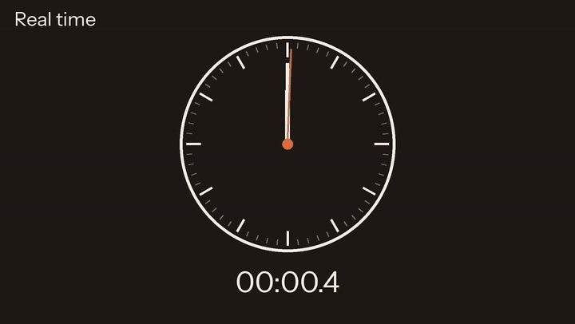
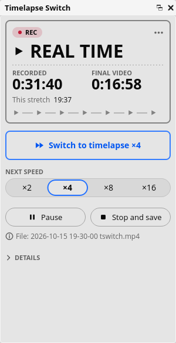
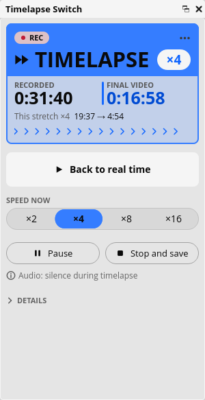
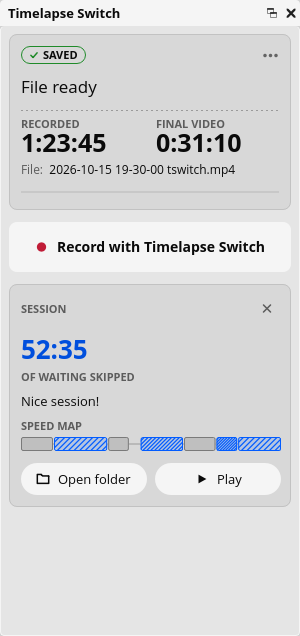

<p align="center">
  <picture>
    <source media="(prefers-color-scheme: dark)" srcset="docs/images/logo-dark.svg">
    
  </picture>
</p>

<p align="center"><strong>Speed up the slow parts of your OBS Studio recordings. While you record.</strong></p>

<p align="center">
  <a href="https://github.com/miguetronic/timelapse-switch/releases/latest"></a>
  <a href="LICENSE"></a>
  <a href="https://github.com/miguetronic/timelapse-switch/actions/workflows/push.yaml"></a>
</p>

<p align="center">
  <a href="https://miguetronic.github.io/timelapse-switch/">Website and guide</a> ·
  <a href="https://github.com/miguetronic/timelapse-switch/releases/latest">Download</a> ·
  <a href="#support-the-project">Support the project</a>
</p>

<p align="center">
  
</p>

Timelapse Switch is a free timelapse plugin for OBS Studio: it lets you switch between real time and timelapse **during** a recording, without pausing. When you press Stop, the file is already finished: the parts you sped up play at x2, x4, x8 or x16, the rest plays at normal speed, and there is nothing left to edit.

## The dock

Everything happens in one dock inside OBS, in the light and dark themes.

<table>
  <tr>
    <td align="center" valign="top">
      <picture>
        <source media="(prefers-color-scheme: dark)" srcset="site/src/assets/dock/dock-real-time-dark.png">
        
      </picture>
      <br><b>Recording</b><br>One button switches to timelapse.
    </td>
    <td align="center" valign="top">
      <picture>
        <source media="(prefers-color-scheme: dark)" srcset="site/src/assets/dock/dock-timelapse-dark.png">
        
      </picture>
      <br><b>Timelapse</b><br>Pick the speed while you record.
    </td>
    <td align="center" valign="top">
      <picture>
        <source media="(prefers-color-scheme: dark)" srcset="site/src/assets/dock/dock-summary-dark.png">
        
      </picture>
      <br><b>Done</b><br>The file is ready, nothing to edit.
    </td>
  </tr>
</table>

## Download

| System | Status | |
|---|---|---|
| Linux (x86_64) | **Tested** on the maintainer's computer. The `.deb` package (Ubuntu 24.04 or later, with OBS from the OBS PPA) is new in 1.0.0 | [Latest release](https://github.com/miguetronic/timelapse-switch/releases/latest) |
| Windows 10 and 11 (x64) | **Beta**: built on every release, not tested yet. Please [report how it works](https://github.com/miguetronic/timelapse-switch/issues/new?template=beta-platform.yml) | [Latest release](https://github.com/miguetronic/timelapse-switch/releases/latest) |
| macOS 12 or later | **Beta**: built on every release, not tested yet. Please [report how it works](https://github.com/miguetronic/timelapse-switch/issues/new?template=beta-platform.yml) | [Latest release](https://github.com/miguetronic/timelapse-switch/releases/latest) |

Needs OBS Studio 31.1 or later. How to install and uninstall each package: the [install guide](https://miguetronic.github.io/timelapse-switch/guide/install/). From a build: `docs/install.md`.

## Who it is for

Anyone whose recordings have long, slow stretches:

- a painter waiting for layers to dry;
- a model maker, a crafter, a cook;
- a developer coding live.

Today you record everything and speed it up later in an editor. With Timelapse Switch, you press a button while recording.

## Why not just lower the frame rate?

It is the usual advice for a timelapse in OBS ([the three ways, compared](https://miguetronic.github.io/timelapse-switch/guide/timelapse-in-obs/)), and it works for a recording that is all timelapse. But OBS cannot change the frame rate in the middle of a recording, so the whole file becomes a timelapse and you still speed it up in an editor afterwards. Timelapse Switch keeps your normal frame rate and decides, frame by frame, which ones go into the file: real time when something happens, timelapse x2, x4, x8 or x16 when it does not, in the same file and with no editing.

## How it works, in one picture

```
   OBS picture  ---->  [ Timelapse Switch ]  ---->  OBS encoder  ---->  one file
                       real time: every frame passes                    mixed speeds,
                       timelapse x4: 1 frame out of 4 passes            ready to upload
```

Think of a tape recorder with a fast-forward pedal: while you hold the pedal, the tape records only 1 of every 4 moments, so that part plays 4 times faster. OBS encoders count frames instead of looking at the clock, so a section with fewer frames simply plays faster.

## What it costs your computer

In short: **the same picture, with some extra work for your computer.**

- **Quality and file size are the same** as with OBS's own Record button: the plugin uses the encoder and the settings of your OBS profile.
- **The extra work comes from the road each frame takes.** To choose which frames go into the file, the plugin needs each frame in the computer's memory (RAM). OBS's own recording with a GPU encoder never takes the frame out of the graphics card. With the plugin, each frame goes down from the card to RAM, waits in three places there (each one a copy), and goes back up to the card's encoder.

```
  OBS alone, GPU encoder           With Timelapse Switch

  card   picture                   card   picture
            |                                |  down the bus
            |                      RAM    OBS's memory feed    6 frames
            |                                |  the valve
            |                      RAM    plugin's feed       16 frames
            |                                |
            |                      RAM    encoder's frame      1 frame
            v                                v  up the bus
  card   encoder                   card   encoder
```

Think of the graphics card as a kitchen and the encoder as its packing station. OBS alone passes each dish from the stove to the packing station without leaving the kitchen. The plugin must look at each dish to decide whether it goes into the box (in timelapse x4, only 1 of every 4 does), and its table is outside the kitchen. So every dish walks out and back in.

Measured on the reference PC (2012 Xeon, Radeon RX 580, Linux), recording 4K at 30 frames per second for 5 minutes:

| What recording added | OBS alone | With the plugin |
|---|---|---|
| CPU | 0.05 cores | 0.47 cores (3 % of that 16-thread CPU) |
| RAM | 7 MB | 293 MB |
| Graphics card memory | 222 MB | 90 MB (less: the plugin keeps its frames in RAM instead) |
| Graphics card power | 16 W | 21 W |
| Lost frames | 0 | 0 |

- **On Linux the plugin takes each frame from the card itself** (road C, `docs/decisions.md`, ADR-012), off the thread that draws OBS's preview, and skips OBS's memory feed: in the same 4K test, 0.37 cores and about 200 MB of RAM.
- **The preview.** While the plugin records, the card has more to do (each frame comes down and the encoder takes it back up), so OBS's preview can look less smooth on some computers. The recording and the rest of the desktop are not affected (`docs/performance.md`, section 9).
- **The cost depends on resolution and frame rate, not on your scene.** OBS draws the scene before the frame reaches either road.
- **Most of that RAM is given back when the recording stops.** The plugin returns its part (211 MB in 4K). OBS keeps its own 75 MB ready until you close it, as it does after any recording with x264.
- **With x264** (or another CPU encoder), OBS itself already takes frames out of the card, so the plugin adds less.

Every step, the numbers for each resolution and how to measure on your own computer: `docs/performance.md`.

## Documentation

- `docs/architecture.md`: how it works inside OBS
- `docs/install.md`: install and uninstall a build, cleanly (releases: the website's install guide)
- `docs/performance.md`: what it costs your computer, and why
- `docs/faq.md`: questions and answers, such as sound and picture timing
- `docs/design/ux-spec.md`: the dock and installation
- `docs/requirements.md`: what it must do
- `docs/decisions.md`: why it is built this way
- `docs/building.md`: how to build it
- `CONTRIBUTING.md`: how we work, including the coding rules (based on NASA/JPL's "The Power of Ten")

## Support the project

Timelapse Switch is free and open source, and it will stay that way. If it saves you editing time, you can help it grow:

- **[Ko-fi](https://ko-fi.com/miguetronic)**: a one-off tip or a monthly one, no account needed.
- **Fund a piece of work**: testing and polishing Windows or macOS, or a feature you need. Priority support can be arranged too. Ask in [Discussions](https://github.com/miguetronic/timelapse-switch/discussions) or with a message on Ko-fi.

Starring the repository, reporting problems and sharing the plugin help too. The plugin itself never asks for money.

## How this project is made

Timelapse Switch is written largely with the help of an AI coding assistant (Claude, by Anthropic), and every change is reviewed by the maintainer. The code follows strict, machine-checked rules (`docs/coding-rules.md`) whoever writes it. Releases are published here on GitHub.

## License

GPL-2.0-or-later, see `LICENSE`.

Timelapse Switch is an independent project by Miguel Parra (Miguetronic). It is not affiliated with or endorsed by the OBS Project. OBS and OBS Studio are trademarks of their respective owners.
