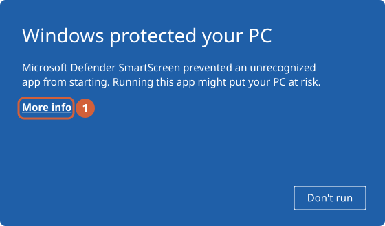
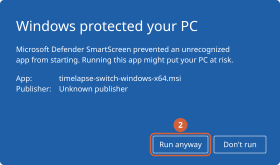
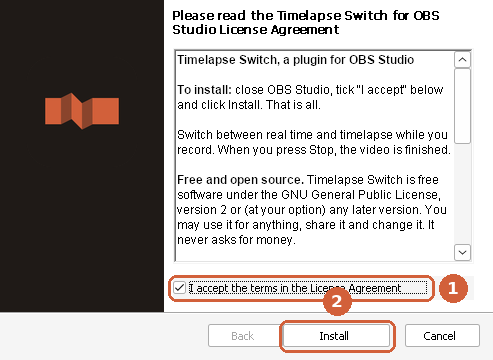
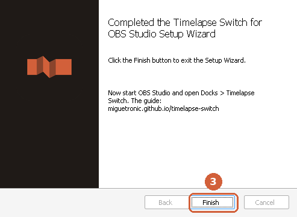
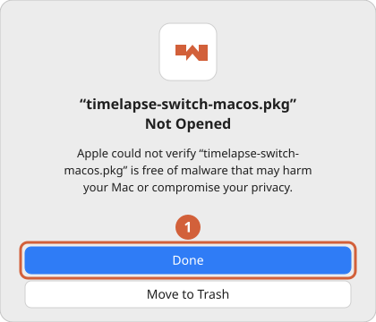
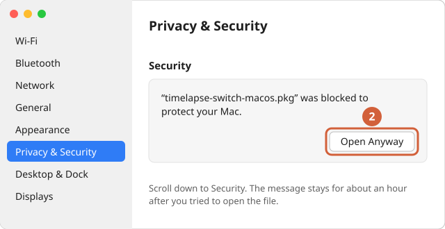
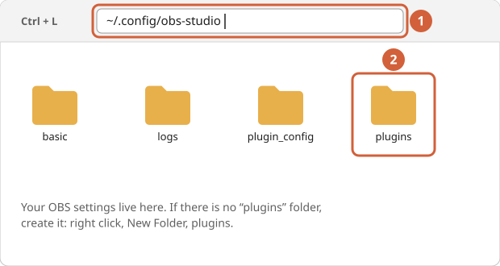
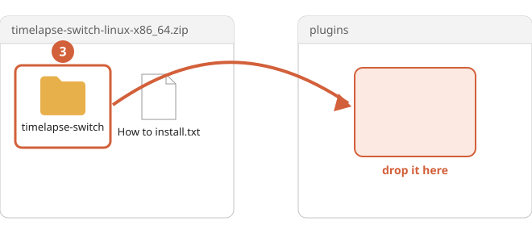
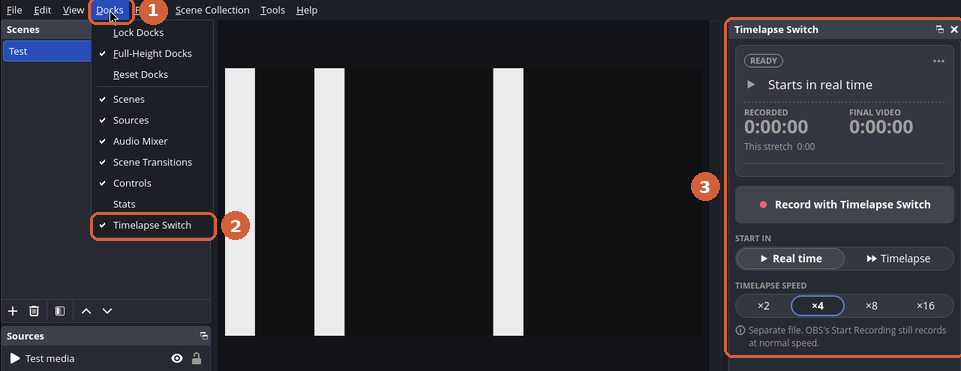
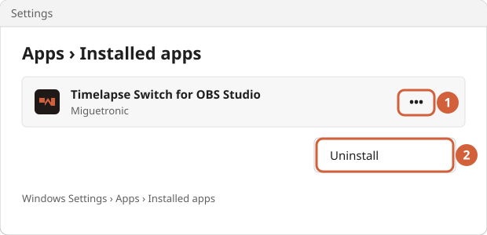

import { Aside, FileTree, LinkButton, Steps, TabItem, Tabs } from '@astrojs/starlight/components';

Installing takes about two minutes and no technical knowledge. Choose your computer below and follow the numbered steps; the pictures show where to click, with an orange outline and a number for the order of the clicks.

Installing adds only the plugin. Your recordings, scenes, settings and other plugins are never touched, and uninstalling takes the plugin away completely.

## Before you start

- **You need OBS Studio 31.1 or later.** To check, open OBS and choose **Help > About**. If yours is older, [update OBS](https://obsproject.com/download) first.
- **Close OBS Studio.** It looks for plugins only when it starts.

## Install

<Tabs syncKey="os">
<TabItem label="Windows" icon="seti:windows">

<Aside type="note" title="Beta">
Windows is built with every release but has not been tested on a real Windows computer yet. If you try it, please [tell us how it went](https://github.com/miguetronic/timelapse-switch/issues/new?template=beta-platform.yml), good or bad.
</Aside>

<Steps>

1. **Download the installer.**

   <LinkButton href="https://github.com/miguetronic/timelapse-switch/releases/latest/download/timelapse-switch-windows-x64.msi" icon="download" iconPlacement="start">Download for Windows</LinkButton>

   If your browser says the file "isn't commonly downloaded", choose **Keep** (in Edge: the **...** button, then **Keep**, then **Keep anyway**). It says that about any new program that few people have downloaded yet.

2. **Close OBS Studio**, if it is open.

3. **Open the file you downloaded.** It is in your **Downloads** folder: double-click `timelapse-switch-windows-x64.msi`.

4. **Windows shows a blue window, "Windows protected your PC".** Click **More info**, then **Run anyway**.

   

   

   Windows shows this for programs without a paid publisher certificate, which the plugin does not have yet. The plugin is free and open source: anyone can read what it does.

5. **Tick "I accept the terms in the License Agreement" and click Install.** When Windows asks "Do you want to allow this app to make changes to your device?", click **Yes**: the plugin goes into OBS's plugin folder, which belongs to all users of the computer.

   

6. **Click Finish.** That is all: now [open the dock](#open-the-dock).

   

</Steps>

<details>
<summary>Install by hand, without the installer</summary>

1. Download <a href="https://github.com/miguetronic/timelapse-switch/releases/latest/download/timelapse-switch-windows-x64.zip">timelapse-switch-windows-x64.zip</a> and open it.
2. Copy the folder `timelapse-switch` from it into `C:\ProgramData\obs-studio\plugins`. If that `plugins` folder does not exist, create it (Windows asks for permission). `ProgramData` is hidden: type the address into File Explorer's address bar.
3. Check that it looks like this, with no extra folder level in between (Explorer's **Extract All** adds one):

<FileTree>
- C:\ProgramData\obs-studio\plugins
  - timelapse-switch
    - bin
      - 64bit
        - timelapse-switch.dll
    - data/
</FileTree>

</details>

</TabItem>
<TabItem label="macOS" icon="apple">

<Aside type="note" title="Beta">
macOS is built with every release but has not been tested on a real Mac yet. If you try it, please [tell us how it went](https://github.com/miguetronic/timelapse-switch/issues/new?template=beta-platform.yml), good or bad.
</Aside>

<Steps>

1. **Download the installer.** It works on Apple silicon (M1 and later) and on Intel Macs.

   <LinkButton href="https://github.com/miguetronic/timelapse-switch/releases/latest/download/timelapse-switch-macos.pkg" icon="download" iconPlacement="start">Download for macOS</LinkButton>

2. **Quit OBS Studio**, if it is open (**OBS > Quit OBS**).

3. **Open the file you downloaded**, `timelapse-switch-macos.pkg`, from your **Downloads** folder. The first time, macOS stops it: "Not Opened". Click **Done**.

   

   macOS does this with installers that are not signed by a paid Apple developer account, which the plugin does not have yet.

4. **Allow it once.** Open **System Settings > Privacy & Security**, scroll down to **Security** and click **Open Anyway**. Confirm with **Open Anyway** again and your password or Touch ID.

   

5. **The installer opens.** Click **Continue**, then **Install**, then **Close**. It installs the plugin for your user only, so it may not ask for a password.

</Steps>

The plugin goes into `~/Library/Application Support/obs-studio/plugins`, as `timelapse-switch.plugin`. Now [open the dock](#open-the-dock).

</TabItem>
<TabItem label="Linux" icon="linux">

One download works on every distribution (Ubuntu, Fedora, Debian, Mint, Arch, CachyOS, Manjaro, openSUSE...) and with OBS from Flathub. Installing is copying one folder; no terminal needed.

<Steps>

1. **Download the plugin.**

   <LinkButton href="https://github.com/miguetronic/timelapse-switch/releases/latest/download/timelapse-switch-linux-x86_64.zip" icon="download" iconPlacement="start">Download for Linux</LinkButton>

2. **Close OBS Studio**, if it is open.

3. **Open the folder of your OBS.** Open your file manager (Files, Dolphin, Nemo, Thunar...), press **Ctrl + L** to type an address, type (or copy and paste) the one that matches your OBS and press **Enter**.

   - OBS from your distribution's packages (most people):

     ```txt
     ~/.config/obs-studio
     ```

   - OBS from Flathub (a Flatpak):

     ```txt
     ~/.var/app/com.obsproject.Studio/config/obs-studio
     ```

   Not sure which one you have? If you installed OBS from an app store (Software, Discover, Software Manager), it is usually the Flathub one. Or try the Flathub address first: if the folder opens, that is yours.

   Neither address opens? OBS creates its folder the first time it runs: start OBS once, close it, and try again.

   

4. **Open the folder `plugins`.** If there is none, create it: right click, **New Folder**, and name it `plugins`, all in small letters.

5. **Open the downloaded `.zip`** (double-click it; it is in your **Downloads** folder) and **drag the folder `timelapse-switch`** from it into `plugins`.

   Some file managers unpack a `.zip` into a new folder when you double-click it, `timelapse-switch-linux-x86_64`. Then open that new folder: the folder `timelapse-switch` to drag is inside it.

   

   It should look like this:

   <FileTree>
   - plugins
     - timelapse-switch
       - bin
         - 64bit
           - timelapse-switch.so
       - data/
   </FileTree>

</Steps>

Now [open the dock](#open-the-dock). The `.zip` also has a file, "How to install.txt", with these same steps.

<details>
<summary>Ubuntu or Debian with OBS from the OBS PPA: the .deb package</summary>

Instead of the `.zip`, you can install <a href="https://github.com/miguetronic/timelapse-switch/releases/latest/download/timelapse-switch-linux-x86_64.deb">timelapse-switch-linux-x86_64.deb</a>: double-click it and choose **Install** in the app store, or in a terminal `sudo apt install ./timelapse-switch-linux-x86_64.deb`. It installs for all users, into OBS's system folders; to uninstall, `sudo apt remove timelapse-switch`. Use the `.deb` or the `.zip`, not both: OBS would find the plugin twice.

</details>

<details>
<summary>OBS from Snap</summary>

The Snap OBS does not load plugins installed by hand. Install OBS from your distribution's packages or from Flathub instead.

</details>

</TabItem>
</Tabs>

## Open the dock

OBS adds new docks hidden, so the first time you show it yourself:

<Steps>

1. **Start OBS Studio.**
2. **Open the menu Docks** at the top.
3. **Click Timelapse Switch.** The dock appears on the right side of OBS. You can drag it by its title to put it anywhere.

</Steps>



Ready: [First steps](/timelapse-switch/guide/first-steps/) shows your first recording. To use the keyboard, bind keys in **Settings > Hotkeys**: every action starts with "Timelapse Switch:" ([Hotkeys](/timelapse-switch/guide/hotkeys/)).

## Something went wrong?

**Timelapse Switch is not in the Docks menu.** Go through these, in order:

1. Close OBS completely and open it again: it looks for plugins only when it starts.
2. Check your OBS version: **Help > About** must say 31.1 or later.
3. Check where the plugin is. The folder `timelapse-switch` must be **directly** inside `plugins`, with `bin` and `data` inside it. A common slip is one folder too many, which happens when a zip is extracted into a folder of its own:

   <FileTree>
   - plugins
     - timelapse-switch this is right
       - bin/
       - data/
   </FileTree>

   <FileTree>
   - plugins
     - timelapse-switch-linux-x86_64 one level too many
       - timelapse-switch
         - bin/
         - data/
   </FileTree>

4. On Linux, check that you used the address of **your** OBS (from your distribution, or from Flathub): each one has its own folder.
5. Ask OBS what it found: **Help > Log Files > View Current Log**. The line `[timelapse-switch] plugin loaded` means the plugin is there. If it is missing, [ask in Discussions](https://github.com/miguetronic/timelapse-switch/discussions) or [report a problem](https://github.com/miguetronic/timelapse-switch/issues/new?template=bug.yml) and attach that log (**Help > Log Files > Upload Current Log File** gives you a link).

**Windows says "A newer version of Timelapse Switch is already installed".** You are installing an older version over a newer one. Uninstall the one you have first (below), or download the latest.

**macOS shows no "Open Anyway" button.** It appears only for about an hour after you tried to open the file. Open the file again, then go back to **Privacy & Security**.

## Update to a new version

- **Windows:** open the new `.msi`. It replaces the old version by itself.
- **macOS:** open the new `.pkg`, the same way as the first time.
- **Linux:** close OBS, delete the folder `timelapse-switch` from `plugins`, and copy in the new one.

Your settings and hotkeys stay.

## Uninstall

<Tabs syncKey="os">
<TabItem label="Windows" icon="seti:windows">

Open Windows **Settings > Apps > Installed apps**, find **Timelapse Switch for OBS Studio**, click the **•••** button next to it, then **Uninstall**.



If you installed by hand, delete the folder `C:\ProgramData\obs-studio\plugins\timelapse-switch`.

</TabItem>
<TabItem label="macOS" icon="apple">

In Finder, choose **Go > Go to Folder**, type `~/Library/Application Support/obs-studio/plugins` and press **Return**. Drag `timelapse-switch.plugin` to the Trash.

</TabItem>
<TabItem label="Linux" icon="linux">

Close OBS and delete the folder `timelapse-switch` from the `plugins` folder where you put it (step 3 of the install shows the address). If you used the `.deb`: `sudo apt remove timelapse-switch`.

</TabItem>
</Tabs>

Uninstalling keeps your settings and hotkeys, in OBS's `plugin_config/timelapse-switch` folder, so installing again later picks them up. Recordings are never touched.

## Check a download

Every release lists the SHA-256 checksum of each file, and an SBOM (the list of what the plugin was built with). To check a file: on Linux `sha256sum <file>`, on macOS `shasum -a 256 <file>`, on Windows `certutil -hashfile <file> SHA256`; compare the result with the release notes.
